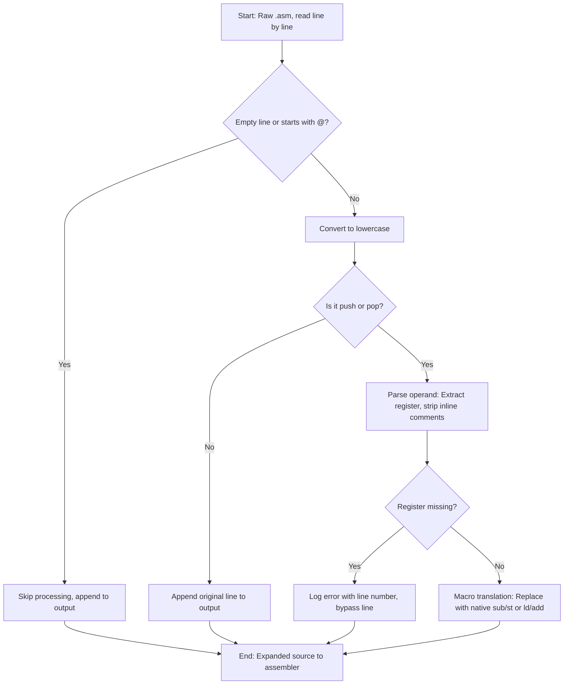

# Assembly Toolchain & Preprocessor

## 1. Preprocessor Subsystem
The preprocessor sanitizes `.asm` code and handles macro translations before the assembler sees the file. It isolates human-readable elements and converts high-level shortcuts to native RISC201 operations.

## 2. Two-Pass Assembler

Converts RISC201 assembly to 8-digit hexadecimal machine code.
*   **Pass 1 (Symbol Resolution)**: Initializes PC at 0. Maps extracted labels to the current PC, incrementing by 4 bytes per valid instruction. Catch syntax errors early.
*   **Pass 2 (Machine Code Generation)**: Resolves opcodes and registers. Parses complex memory formats like `imm[rs1]` for `ld`/`st`. Validates strict immediate bounds ($-32768$ to $32767$ for `mod=0`). Generates one 32-bit hex word per instruction.

## 3. Disassembler

Reverses the hex machine code to reconstruct valid assembly text. 
*   **Binary Translation**: Unpacks the 32-bit machine code via `decode(uint32_t)`. It checks the `isImm` flag and 2-bit `mod` field to dynamically append `u` or `h` suffixes back onto mnemonics (e.g., `addu`).
*   **Formatting Constraints**: Partitions output to ignore unused fields. For example, it strictly hides the `rd` field for `cmp`, and `rs1` for `mov` to prevent printing junk data.