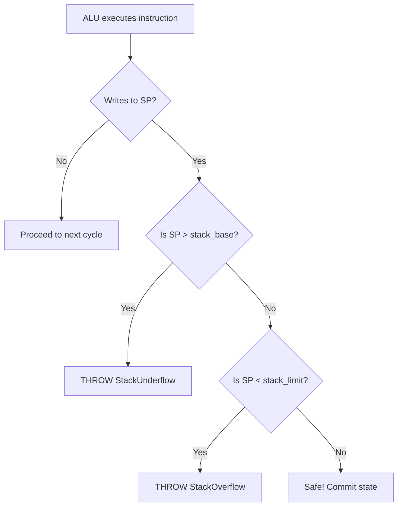
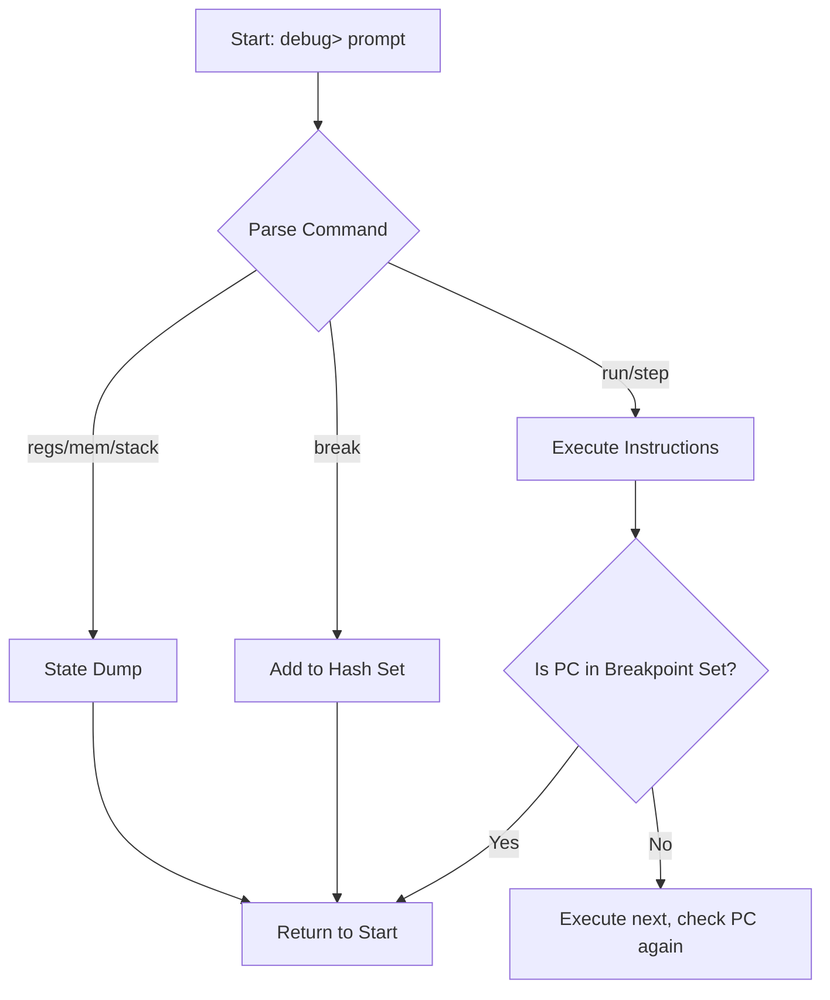

### Interactive CLI Debugger Commands

You can start the interactive debugger by passing the `-d` or `--debug` flag when launching the simulator. Once inside the `debug>` prompt, the following commands are available:

* **`step [n]`**: Executes `n` instructions (defaults to 1 if no number is provided).
* **`run`**: Executes the program continuously until completion or until an active breakpoint is hit.
* **`break <addr>`**: Toggles a breakpoint on or off at the specified hexadecimal memory address.
* **`regs`**: Dumps the current architectural state of all CPU registers.
* **`mem <addr> [n]`**: Displays `n` words of raw memory starting at the specified hexadecimal address.
* **`stack`**: Renders an ASCII visualizer of the current stack memory boundaries and pointer location.
* **`mode <type> [sub]`**: Dynamically switches the CPU architecture (`single`, `pipe4`, `pipe6`) and micro-mode (`hard`, `hmicro`, `vmicro`), automatically resetting the CPU and reloading the binary.
* **`reset`**: Resets the CPU architectural state and reloads the assembled program into memory.
* **`pipe`**: Renders a cycle-by-cycle ASCII diagram of the instructions currently held in the pipeline latches, along with current stall and flush counts.
* **`micro`**: Prints the exact control ROM address (`currentMicroPC`) for the instruction currently in the Execution stage.
* **`latency`**: Displays the simulated nanosecond execution time and percentage overhead for each pipeline stage.
* **`help`**: Prints the inline list of available debugger commands.
* **`quit`** (or **`q`**): Exits the interactive debugger and terminates the simulation.

# System Safety & Interactive Debugger

## Hardware Exceptions & Safety

The simulator utilizes custom C++ exception classes (`StackOverflow`, `StackUnderflow`, `IllegalInstruction`) trapped inside the execution loop to prevent software crashes.

* **Precise Exceptions**: In the 6-stage pipeline, bounds violations are detected in `MA1`, but the crash is deferred until `MA2`. This allows any older, valid instructions to finish writing to registers without being corrupted by the crash state.

* **Safe Halting**: Upon an exception, the system prints a hardware error, locks the PC, and dumps a post-mortem register snapshot.

## Interactive Debugger Subsystem

Triggered with the `-d` flag, bypassing batch execution for a cycle-by-cycle REPL CLI.

