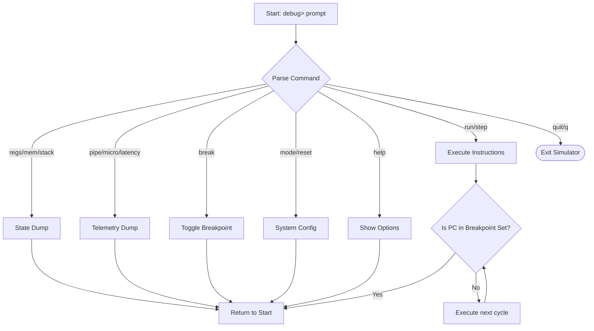
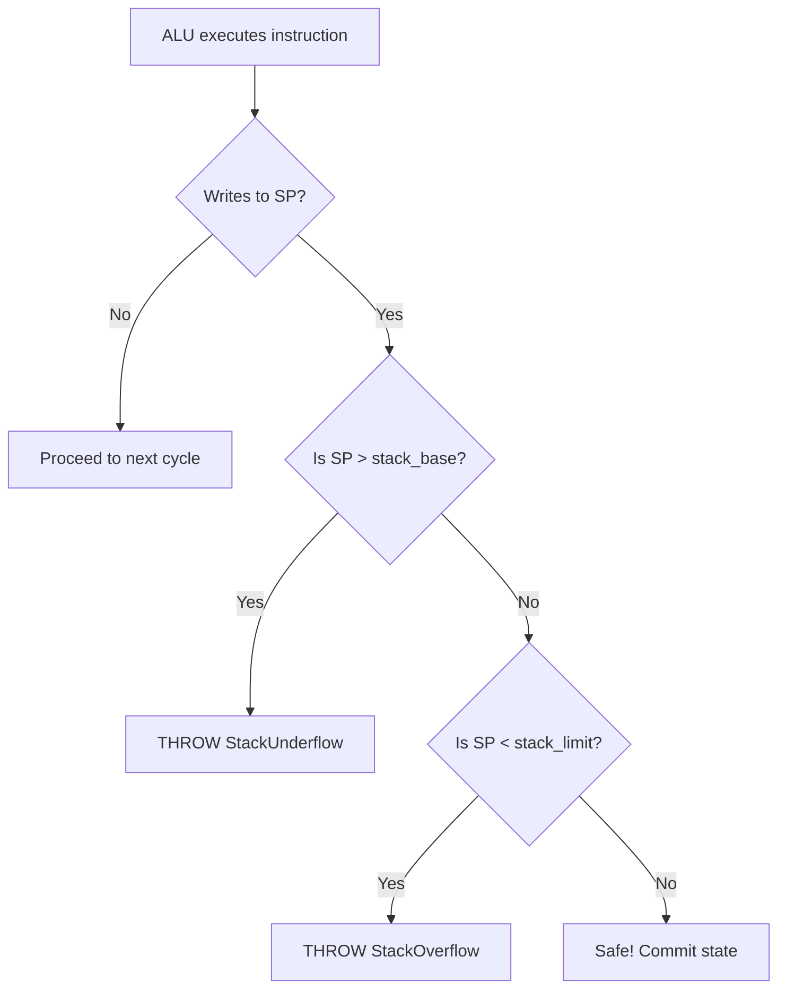

# System Safety & Interactive Debugger

## Interactive Debugger Subsystem

Triggered by passing the `-d` or `--debug` flag at startup, this subsystem bypasses the standard batch execution loop, dropping the user into a cycle-by-cycle REPL (Read-Eval-Print Loop) command-line interface.

### Complete Command Reference

Once inside the `debug>` prompt, you have total control over the simulated hardware clock and memory:

* **`step [n]`**: Executes `n` instructions (defaults to 1 if no number is provided), allowing cycle-by-cycle inspection.

* **`run`**: Executes the program continuously until completion or until an active breakpoint is hit.

* **`break <addr>`**: Toggles a non-destructive hardware breakpoint on or off at the specified hexadecimal memory address.

* **`regs`**: Dumps the current architectural state of all 32 CPU registers.

* **`mem <addr> [n]`**: Displays `n` words of raw memory starting at the specified hexadecimal address.

* **`stack`**: Renders a visual, top-down ASCII map of the stack memory boundaries relative to the current `sp` location.

* **`mode <type> [sub]`**: Dynamically hot-swaps the CPU architecture (`single`, `pipe4`, `pipe6`) and micro-mode (`hard`, `hmicro`, `vmicro`). Automatically resets the CPU and reloads the binary mid-session.

* **`reset`**: Resets the CPU architectural state and reloads the assembled `.hex` program into memory.

* **`pipe`**: Renders a real-time ASCII diagram of the instructions currently occupying the pipeline latches, alongside stall and flush metrics.

* **`micro`**: Prints the exact control ROM address (`currentMicroPC`) for the instruction currently in the Execution stage.

* **`latency`**: Displays the simulated nanosecond execution time and percentage overhead for each pipeline stage.

* **`help`**: Prints the inline list of available debugger commands.

* **`quit`** (or **`q`**): Safely exits the interactive debugger and terminates the simulation.

## Hardware Exceptions & Safety

The simulator utilizes custom C++ exception classes (`StackOverflow`, `StackUnderflow`, `IllegalInstruction`) trapped inside the execution loop to prevent host software crashes and accurately model hardware-level faults.

To maintain architectural integrity when these faults occur, the pipeline handles them deterministically:

* **Precise Exceptions**: In the 6-stage pipeline, bounds violations are detected during address calculation in `MA1`, but the actual crash sequence is deferred until `MA2`. This ensures that any older, valid instructions currently in flight finish writing back to the registers without being corrupted by the speculative crash state.

* **Safe Halting**: Upon an unrecoverable exception, the system prints a detailed hardware error, locks the Program Counter (PC), and dumps a post-mortem register snapshot for analysis.
