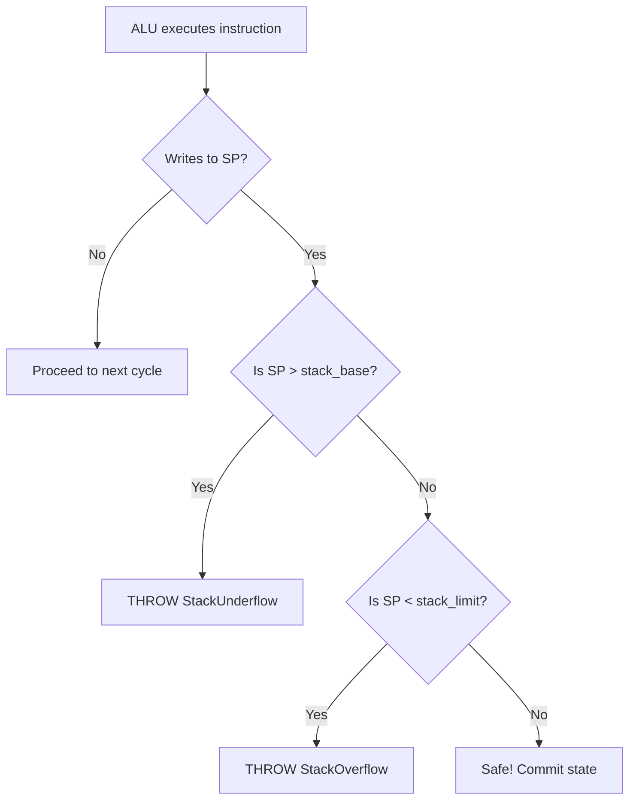
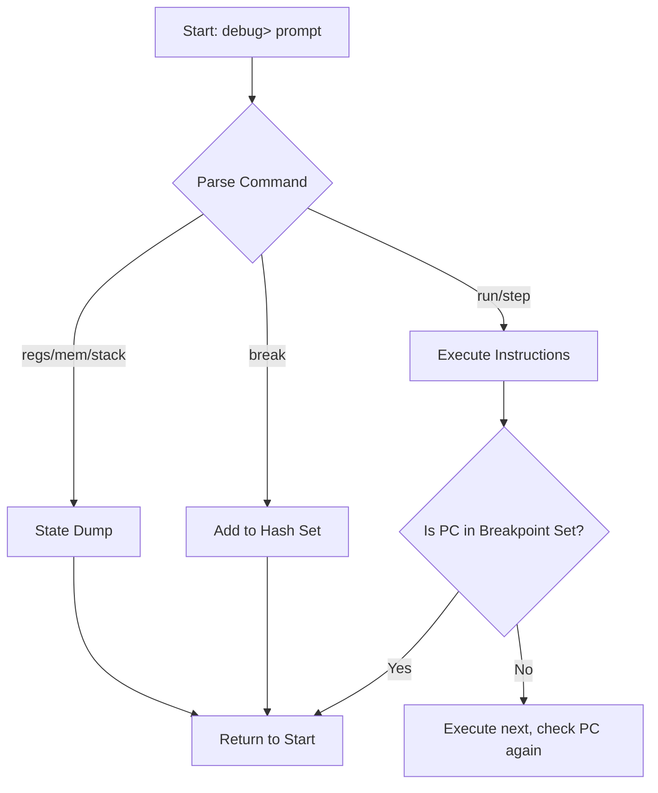

# System Safety & Interactive Debugger

## Hardware Exceptions & Safety

The simulator utilizes custom C++ exception classes (`StackOverflow`, `StackUnderflow`, `IllegalInstruction`) trapped inside the execution loop to prevent software crashes.

* **Precise Exceptions**: In the 6-stage pipeline, bounds violations are detected in `MA1`, but the crash is deferred until `MA2`. This allows any older, valid instructions to finish writing to registers without being corrupted by the crash state.

* **Safe Halting**: Upon an exception, the system prints a hardware error, locks the PC, and dumps a post-mortem register snapshot.

## Interactive Debugger Subsystem

Triggered with the `-d` flag, bypassing batch execution for a cycle-by-cycle REPL CLI.

**Key Commands:**

* `step [n]`: Steps the hardware clock forward exactly $n$ cycles.

* `stack`: Visual, top-down ASCII map of the stack memory relative to `sp`.

* `pipe`: Prints a visual diagram of instructions currently occupying the pipeline latches.

* `mode <type>`: Hot-swaps the architecture mid-session (e.g., swapping from `pipe4 hmicro` to `pipe6 vmicro`), resetting the memory and core instantly.