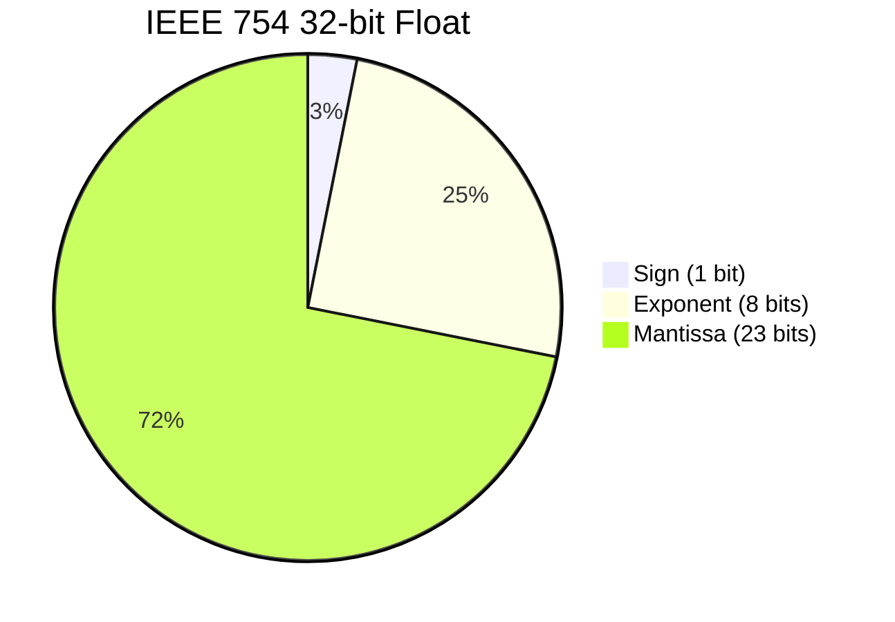

# Floating Point Unit (FPU)

The IEEE 754 single-precision co-processor. It processes raw 32-bit patterns, returning calculated floats and standard hardware exception flags (invalid, div-by-zero, overflow, underflow, inexact).

## IEEE 754 Structure

*   **Exponent**: Stored with a bias of 127.
*   **Mantissa**: Stored with an implied leading `1` (for normal numbers).

## The 5-Stage Operation Pipeline

Every operation (`FADD`, `FSUB`, `FMUL`, `FDIV`, `FSQRT`) routes through these exact 5 functional stages:

1.  **Unpack**: Splits fields. Restores the hidden `1` and removes the 127 bias.
2.  **Operate**: 
    *   *Add/Subtract*: Shifts the smaller number right to match exponents, then routes mantissas through the main ALU's Brent-Kung adder.
    *   *Multiply*: Adds exponents, subtracts bias, multiplies mantissas to produce an exact 48-bit product.
    *   *Square Root*: Converts to double, calculates root, and feeds back to single-precision via `roundPack`.
3.  **Normalize**: Shifts the result left or right until the mantissa is reformed as $1.xxx$.
4.  **Round**: Utilizes extra fractional bits (round bit, sticky bit) to cut down to 23 bits. Evaluates rules: nearest-even, toward zero, toward $+\infty$, toward $-\infty$.
5.  **Pack**: Restores the bias, joins the Sign, Exponent, and 23-bit Mantissa back into 32 bits. Converts overflow to $\infty$ or tiny results to denormals.