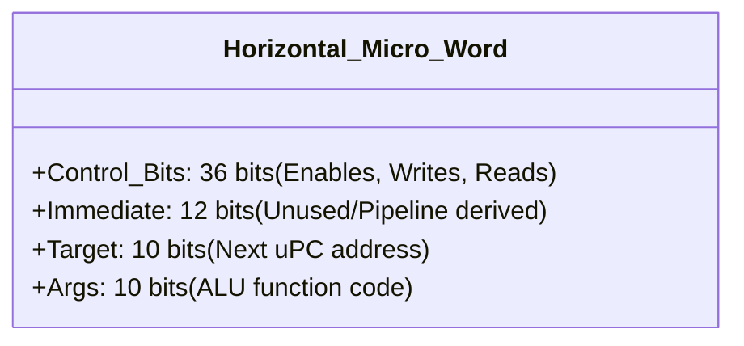
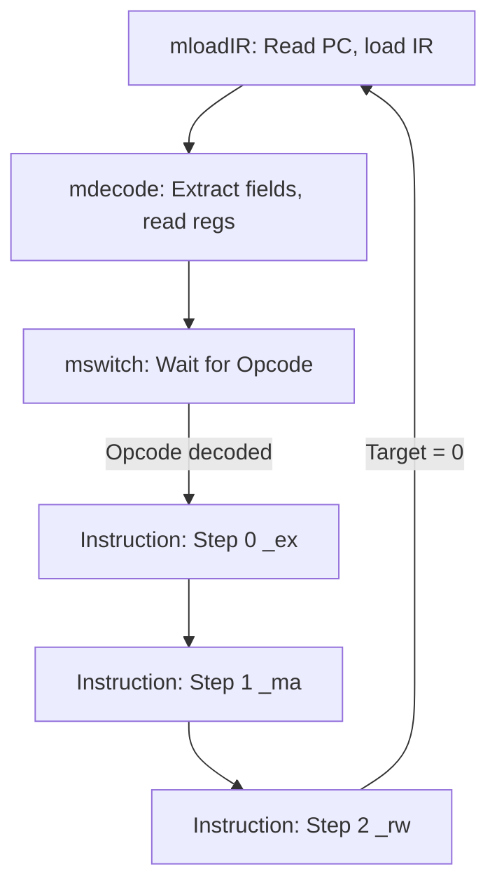

# Horizontal Microprogramming

To decouple instruction logic from circuit wiring, the CPU utilizes a micro-program ROM. Altering instruction behavior requires changing a ROM table entry rather than physical hardware.

## The 68-bit Control Word

Every micro-instruction relies on a flat, 68-bit control word that directly drives hardware muxes and latches without decoder delay.

*   **Control Bits (36)**: One bit per hardware signal (e.g., `ALU_RESULT_WRITE`, `IMMX_EN`, `PC_WRITE`).
*   **Args (10)**: Sends function codes like `aluop::ADD` to the ALU.

## ROM Layout & Sequencing

The control ROM houses exactly 3 words per standard instruction.

*   **Pipelining Sync**: Because instructions occupy Execute (EX), Memory (MA), and Writeback (RW) simultaneously, a single global micro-PC cannot work. Instead, each stage independently queries the ROM using the formula: `Address = entryFor(opcode) + step`.
*   **Padding**: Even if an instruction doesn't use a stage (e.g., `add` has no memory access), an empty all-zero word is assigned to MA to preserve the 3-step uniform sequence.