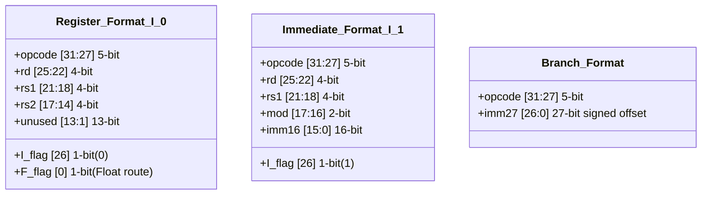

# RISC201 Instruction Set Architecture (ISA)

## Architecture Overview
The RISC201 is a custom 32-bit architecture utilizing 16 general-purpose registers (`r0` through `r15`). 
*   **Special Registers**: `r14` is explicitly mapped to the Stack Pointer (`sp`), and `r15` is mapped to the Return Address (`ra`).
*   **Program Termination**: There is an explicit architectural decision to omit a `halt` pseudo-instruction. Programs terminate naturally when the Program Counter (PC) runs past the memory boundary.

## Instruction Formats
The architecture standardizes around three unified 32-bit data layouts to simplify decoding:

*   **Register Format ($I=0$)**: Encodes a 5-bit opcode with three register operands. The 0th bit acts as the `isFloat` ($F$) flag, routing operations dynamically to the FPU.
*   **Immediate Format ($I=1$)**: Uses a 16-bit immediate combined with a 2-bit modifier (`mod`). 
    *   `00`: Standard sign-extension.
    *   `01`: Unsigned zero-extension (suffix `u`).
    *   `10`: Shift to high 16 bits (suffix `h`).
*   **Branch Format**: Utilizes a 27-bit signed offset calculated via $(target - currAddr) / 4$.

## Custom Logic & Control Extensions

To minimize control-flow disruption and pipeline flushes, 6 custom logical instructions were mapped to unused opcodes (21-26). Instead of doing 4 instructions and 2 branches for compound conditions `if(Conda & Condb)`, it can be done in 2 instructions.
*   **Flag-Setting (`land`, `lor`, `lnot`)**: Treat operands as booleans (non-zero is true). They bypass standard register output and directly set the `flag_land`, `flag_lor`, and `flag_lnot` hardware flags.
*   **Branching (`bland`, `blor`, `blnot`)**: Operate identical to `beq`, but check the newly established logical flags, allowing complex conditions to resolve in a single branch step.