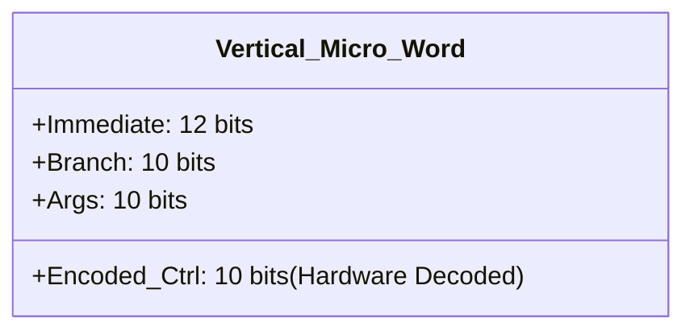
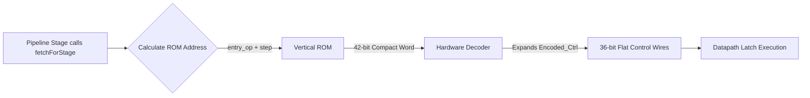

# Vertical Microprogramming

Vertical microprogramming vastly reduces the footprint of the control ROM by grouping mutually exclusive signals into compact encoded fields, decoding them back to horizontal wires on the fly.

## The Compact 42-bit Word

Instead of storing 36 flat control lines, the vertical ROM condenses state into 10 bits.

The 10 Encoded Control bits are partitioned as:

* `FetchSource (2b)`: Dictates next micro-PC (next word, jump, switch).

* `VDataPathCtrl (3b)`: Encodes 7 datapath states (e.g., `ALU_COMPUTE`, `MEM_LOAD`).

* `VPcCtrl (2b)`: Encodes branch/call/ret logic.

* `VFlagCtrl (3b)`: Encodes the 7 flag update combinations.

## Hardware Lookup & Decoder Integration

This system offers 72% fewer control bits in ROM while maintaining drop-in compatibility with the physical datapath.

* **Decoder Matrix**: The combinational `decode()` unit acts as simulated hardware. If it reads `VDataPathCtrl::MEM_LOAD` in Stage 1, it actively drives the `ALU_COMPUTE`, `MAR_WRITE`, and `MDR_WRITE` physical wires high.